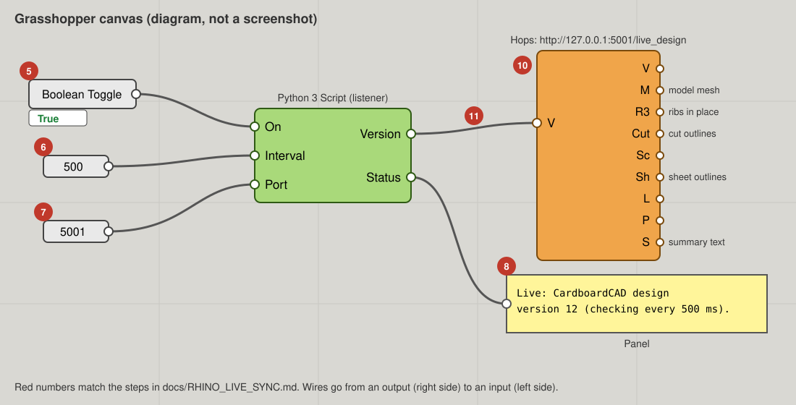
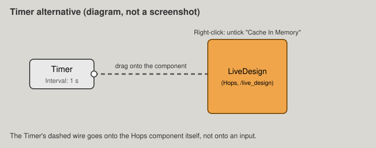

# Rhino live sync

Show the design that is open in Fold Theory inside Rhino, and keep it up to
date while you (or the Design Assistant) change it. You can also send a mesh
from Rhino to Fold Theory.

You need: Rhino 8 for Mac (Rhino 7 works too), with Hops installed (type
`PackageManager` in Rhino's command line, search **Hops**, **Install**,
restart Rhino), and Fold Theory running with the **green** engine dot.

## How it works

Hops only asks the engine for an answer when one of its inputs changes. So
the live link has two Grasshopper pieces:

```
 Fold Theory app                         Grasshopper
 ───────────────                          ───────────
 design changes ──► version 12            [Fold Theory Live listener]  (Python script component)
                    /api/design/version ◄── asks every 0.5 s, in the background
                                              │ Version = 12 (only re-runs when it changes)
                                              ▼
 /live_design   ◄──────────────────────── [Hops: LiveDesign]  V input
                ──────────────────────────► Model, Parts 3D, Cut, Score, Sheets, Labels, Parts, Summary
```

1. **Fold Theory Live listener**: a short Python script for a Grasshopper
   script component. It asks the app for its *design version*, a number that
   goes up every time the design changes. It does this on a background
   thread, and only re-runs the Grasshopper definition when the number
   changes, so nothing is recomputed while the design stays the same.
2. **LiveDesign** (Hops, `http://127.0.0.1:5001/live_design`): give it the
   version, and it returns the app's current design as Rhino geometry.

And the other way:

3. **SendToFoldTheory** (Hops, `http://127.0.0.1:5001/send_to_cardboardcad`):
   a mesh from Rhino becomes the app's model, ready for the Design Assistant
   to slice, nest and cost ("make this a waffle from 6 mm board").

Everything stays on your own Mac (`127.0.0.1`). Nothing goes over the network.

## Set it up (once per Grasshopper file)

Before you start: Fold Theory is open, the dot in its bottom-left corner is
**green**, and the Design Assistant has made something (for example "make a
cylinder stool 450 mm tall as a waffle"), so there is a design to see.

Grasshopper basics used below:
- **Add a component:** double-click an empty part of the canvas, type its
  name in the search box that appears, press Return.
- **Wire two components:** press on the small half-circle on the *right*
  side of one (an output), drag to the half-circle on the *left* side of the
  other (an input), let go.
- **Colours:** grey or green means fine, **orange** means a warning (hover
  over the little balloon at its top-right corner to read it), **red** means
  an error.

When you are done, the Grasshopper canvas looks like this. The red numbers
are the step numbers below.



*This is a diagram, not a screenshot. Real screenshots go in
`docs/images/screenshots/` (see the list at the end of this page).*

### Step 1: add the listener (Python script component)

1. In Fold Theory choose **Design > Copy Rhino Live Listener Script**.
2. In Grasshopper, double-click the canvas, type `Python 3 Script`, press
   Return. (Rhino 7: type `GhPython`.)
3. Double-click the new component to open its editor, press ⌘A then ⌘V to
   replace everything with the script, then close the editor.
4. Rename its inputs and outputs so it shows **On**, **Interval**, **Port**
   on the left and **Version**, **Status** on the right: zoom in until small
   **+** / **−** signs appear to add or remove one, and right-click each name >
   type the new name in the box at the top of the menu, press Return.

### Step 2: give the listener its three inputs

5. **On:** double-click the canvas, type `Boolean Toggle`, press Return. A
   small box saying **False** appears. Double-click it so it says **True**.
   Wire its right side to the listener's **On**.
6. **Interval:** double-click the canvas and type `500` (just the number),
   press Return. Grasshopper makes a small number box holding 500. Wire it to
   **Interval**. (500 means "check twice a second".)
7. **Port:** the same way, type `5001`, press Return, and wire it to **Port**.
   (Use the port shown in Fold Theory **Settings** if you changed it.)

### Step 3: see what the listener is doing

8. Double-click the canvas, type `Panel`, press Return. A yellow note
   appears. Wire the listener's **Status** output into the panel's left side.
   Within a second it should read
   `Live: Fold Theory design version 7 (checking every 500 ms).`
   (any number). If it says `Waiting for Fold Theory on port 5001`, the app
   is not running or the port is wrong.

### Step 4: add LiveDesign (the Hops component that brings the design in)

9. Double-click the canvas, type `Hops`, press Return. A grey Hops
   component appears.
10. Right-click it > **Path…**, paste `http://127.0.0.1:5001/live_design`,
    click **OK**. It turns into **LiveDesign** with one input, **V**, and
    outputs **V, M, R3, Cut, Sc, Sh, L, P, S**.
11. Wire the listener's **Version** output to LiveDesign's **V** input.

### Step 5: look at it in Rhino

12. Switch to the Rhino window. The design is already drawn in the
    viewports as a light red preview: the model (**M**), the ribs in place
    (**R3**) and the flat cut sheets beside it on the ground (**Cut**, **Sc**,
    **Sh**). Grasshopper previews every output. Type `Zoom` > **All**
    (or double-click the middle mouse button) if you can't see it.
13. To show only some of it: right-click the LiveDesign component and
    untick **Preview** (everything disappears), then add a `Custom Preview`
    component and wire just the output you want (for example **M**) into its
    **G** input.
14. Optional: wire **S** into another Panel to read the size, method, sheets
    and cost.

### Step 6: check that it is live

15. In Fold Theory, ask the assistant for a change, for example "use 6 ribs
    each way". In Grasshopper the Status panel's version number goes up, and
    the preview in Rhino changes within about half a second.

That's it. To stop live updates, double-click the Boolean Toggle so it says
**False**. To keep a copy as real Rhino geometry, right-click an output
(**M**, **Cut**…) > **Bake…** > **OK**; baked objects stay as they are.

Save the Grasshopper file (**File > Save Document** in the Grasshopper
window) so you don't have to wire this again.

### Simpler alternative: no script, just a Timer

If you would rather not use the script, Grasshopper's own Timer can ask the
app again and again. It re-downloads the design on every tick even when
nothing changed, so it uses more computer time, but it has fewer steps:



*Diagram, not a screenshot.*

1. Do steps 9 and 10 above (Hops with `http://127.0.0.1:5001/live_design`).
2. Right-click the Hops component and **untick Cache In Memory** (otherwise
   Hops keeps returning its first answer).
3. Double-click the canvas, type `Timer`, press Return. Wire the Timer's
   output (right side) onto the Hops component itself. Right-click the
   Timer > **Interval** > 1 second.

### Ready-made Grasshopper file

There is no ready-made `.gh` file yet: Grasshopper files can only be made
reliably inside Grasshopper. Once you have wired steps 1 to 11, save the
file as `Fold Theory Live.gh` and it can be added to this repository
(`rhino/Fold Theory Live.gh`) for everyone to open instead of wiring.

### LiveDesign's outputs

| Output | What |
|---|---|
| **V** | the design version these outputs show |
| **M** | the 3D model (mesh, mm) |
| **R3** | the ribs or layers in place (outline curves of the assembly) |
| **Cut** | cut outlines, on the XY plane, sheets laid side by side (100 mm apart) |
| **Sc** | score and etch lines on the sheets |
| **Sh** | one rectangle per sheet of board |
| **L** | part labels, sheet by sheet |
| **P** | the parts document: connect it to the `/nest` or `/export` Hops components |
| **S** | a text summary: size, method, sheets, cost |

### Send a Rhino model to Fold Theory (optional)

1. Another Hops component with path `http://127.0.0.1:5001/send_to_cardboardcad`.
2. Connect a closed mesh to **M** (for a Brep or a Rhino object, use
   **Params > Geometry > Brep**, right-click **Set one Brep**, then
   **Mesh > Util > Mesh Brep** in front of **M**). Model in millimetres.
3. Type a name into **N** with a **Panel**, for example `Stand v2`.
4. Connect a **Button** (Params > Input > Button) to **S**. Click it to send.
   The app's preview shows the mesh, and the assistant can work on it.

Sending replaces the app's model and clears its parts. Do **not** connect
LiveDesign's **M** into SendToFoldTheory's **M**: that would send the
design back to itself.

## Troubleshooting

| What you see | What to do |
|---|---|
| Status: `Waiting for Fold Theory on port 5001` | Start Fold Theory. Wait for the green dot. If you changed the port in Settings, connect a Panel with that number to **Port**. |
| LiveDesign is orange with "Unable to connect" | Same as above; and check the Hops path is `http://127.0.0.1:5001/live_design` (not `localhost`). |
| Grasshopper does not update | Is **On** True (or unconnected)? Does Status show a version number that changes when you change the design? If the number changes but LiveDesign does not, check the wire from **Version** to **V**. |
| The listener stopped after editing the script | Recompute: Grasshopper menu **Solution > Recompute** (F5). |
| `M` is empty, Summary says "No design" | The app has no model yet. Make one in the Design Assistant, or open a project (**File > Open Project…**). |
| Anything else | Open the app's **Diagnostics** tab (above the preview) and pick the **Grasshopper** source, or ask the Design Assistant "why is Grasshopper not updating?". The listener reports when **On** turns off and on (with the last version it saw), and the engine records every LiveDesign fetch and SendToFoldTheory. To get the reporting, paste the listener script in again from **Design > Copy Rhino Live Listener Script**. |

## Screenshots still to add

The pictures on this page are drawings. Real screenshots help most here; save
them as PNG in `docs/images/screenshots/` with these names and they can be
swapped in:

| File | What it should show |
|---|---|
| `01-script-component-renamed.png` | the Python 3 Script component with On, Interval, Port / Version, Status (step 4) |
| `02-hops-path-dialog.png` | the Hops **Path…** dialog with `http://127.0.0.1:5001/live_design` (step 10) |
| `03-canvas-wired.png` | the whole canvas after step 11, Status panel reading `Live: …` |
| `04-rhino-viewport.png` | Rhino's Perspective view with the model, ribs and sheets previewed (step 12) |

## For developers

- `GET /api/design/version` → `{"version": N}`.
- `GET /api/design/live?since=N` → `{"version": N, "changed": false}` when
  nothing changed, otherwise the whole design as plain JSON (model vertices
  and faces, parts in 3D, sheets with cut/score/etch polylines, the parts
  document). Usable from any script that cannot run Hops.
- The listener's polling logic (`poll_version`, `VersionWatcher`) is tested
  in `engine/tests/test_live_sync.py` without Rhino.
