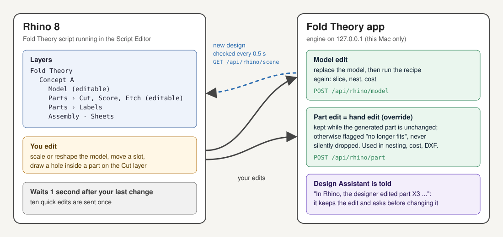

# Rhino two-way link (no Grasshopper needed)

See the Fold Theory app's design in plain Rhino as real, tagged Rhino
objects, and edit it there with the mouse. The edits come back to the app:

- **Edit the model** (scale it, move control points, turn it into SubD, put
  a new mesh on the Model layer) and the app replaces its model and runs the
  recipe again: slice, nest, cost. The new parts come back into Rhino.
- **Reshape a flat part** (move a slot, draw a handle hole, change an
  outline) and it becomes a **hand edit** (an override) that the app keeps.
  Nesting, the cost and the cut files use your version.
- The **Design Assistant is told** what you changed, keeps it, and asks
  before changing a part you edited.

Everything stays on your own Mac (`127.0.0.1`). This replaces nothing: the
Grasshopper link in [RHINO_LIVE_SYNC.md](RHINO_LIVE_SYNC.md) still works.



*This is a diagram, not a screenshot.*

> **Status: prototype, not yet tried in Rhino.** The engine side and the
> script's own logic are tested in CI (`engine/tests/test_rhino_two_way.py`).
> The part that talks to Rhino (layers, document events, drawing objects)
> could not be run where it was written, because Rhino isn't available
> there. The checklist at the end of this page says what to try first.

You need: **Rhino 8** for Mac, and the Fold Theory app running with the
**green** engine dot.

## Set it up (about two minutes, once per Rhino session)

1. **Make a design in the app.** For example ask the Design Assistant:
   "make a box stool 300 x 300 x 450 mm as a waffle with 5 ribs each way,
   nested on 1200 x 800 sheets".
2. **Copy the script.** In the app choose **Design > Copy Rhino Two-Way
   Script**. (If that menu item is missing, open
   `http://127.0.0.1:5001/rhino/fold_theory.py` in a browser, then
   Edit > Select All and Edit > Copy.)
3. **Open Rhino's Script Editor.** In Rhino, click in the command line at the
   top, type `ScriptEditor` and press Return.
4. **Make a new Python 3 script.** In the Script Editor, click the **New**
   button (the page with a **+**) and choose **Python 3**. A new tab opens.
5. **Paste.** Click in the new tab, press **⌘A** then **⌘V**.
6. **Run it.** Click the green **Run** button (▶), or press **F5**.

Rhino's command line says
`Fold Theory: connected on port 5001. Run the script again to stop.`
Within a second the design appears in the viewports, on these layers (open
the **Layers** panel to see them):

```
Fold Theory
└── Design                  ← the app's project name once you save it, e.g. "Acme Expo - Concept A"
    ├── Model               ← the 3D model (mesh). Edits here re-run the recipe
    ├── Assembly            ← ribs or layers in place (look only)
    ├── Parts
    │   ├── Cut             ← cut outlines and holes. Edits here make a hand edit
    │   ├── Score           ← fold lines. Edits here make a hand edit
    │   ├── Etch            ← alignment marks
    │   └── Labels          ← part names (look only)
    └── Sheets              ← one rectangle per sheet of board (look only)
```

The flat parts lie on the ground plane, sheet by sheet, 100 mm apart, the
same way the app's **Sheets** tab shows them. Each part's curves are grouped,
so one click selects the whole part.

To **stop**, run the script again (green Run button). The objects stay in
Rhino as ordinary geometry. Save the script with **File > Save** in the
Script Editor (for example as `Fold Theory.py`) so next time you only need
steps 3 and 6.

You can hide or lock any of these layers; the script keeps your layer
settings when it updates the objects.

## Things to try

### Make the stool taller

1. Select the model (click it), type `Scale1D` and press Return.
2. Click the bottom of the model as the base point, then the top, then type
   `600` for the new height (if the model is 450 mm tall now). Press Return.
3. Wait a second. The command line says
   `Fold Theory: sending your model edit to the app...` and then
   `Model edited in Rhino: now box: 300 x 300 x 600 mm ... Ran waffle_slice, nest_sheets again.`
4. The parts in Rhino are replaced by the new, taller ribs, and the app's
   preview and cost update.

Your model object stays as it is in Rhino (it isn't redrawn), so a SubD or
Brep keeps its control points. The app gets a mesh of it.

### Move a slot on a rib

1. Find rib **X3** on the sheets (its label says X3). Click one of its cut
   curves to select the part, then click again on just the outline.
2. Press **F10** to show its control points. Drag a window around the four
   points of one slot (the notch), then type `Move`, click a start point and
   move it 20 mm along the rib. Press **F11** to hide the points.
3. A second later the command line says
   `X3 edited in Rhino (cut length ...). It is now a hand edit (override).`
   In the app, X3 shows the moved slot, and the exported DXF has it.

### Add a handle hole

1. Make the **Cut** layer current: in the Layers panel, double-click
   `Fold Theory > Design > Parts > Cut` (a check mark appears).
2. Draw a closed curve inside a part's outline, for example `Rectangle`, or
   `Slot` for a rounded handle.
3. The script adds it to the part it is inside, and the app counts it in the
   cut length and cost ("1 more hole").

### What happens to a hand edit later

- **The same settings run again** (you or the assistant re-slice with the
  same ribs and thickness): the hand edit is **kept**.
- **The part itself changes** (for example 4 Y ribs instead of 5, so X3's
  slots move, or a thicker board): the hand edit **no longer fits**. The app
  uses the generated X3 and says so, but keeps your edit. If you go back to
  the old settings, it comes back.
- **The part is gone** (fewer X ribs): the edit is kept but not used.
- **Only moving** a whole part on its sheet is not a hand edit: the nesting
  decides where parts go, so it moves back.
- **Making a new model** in the app (a new shape or file) clears hand edits.
  Scaling keeps them, but they stop fitting until you redo them.
- Hand edits are saved with the project (`project.json`, `rhino_overrides`)
  and come back when you reopen it.
- To remove one, ask the assistant ("remove the hand edit on X3"), or redraw
  the part back to its generated shape.

### When both sides changed something

If the app changed an object (say the assistant re-sliced) while you were
editing the same object in Rhino, **your Rhino edit wins** for that object
and the app says what it replaced, for example
`It replaced a newer X3 made in the app.`

### What the Design Assistant sees

The next time you write in the chat, the assistant is first told what you
changed in Rhino, for example
`In Rhino, the designer edited part X3 (1 more hole). It is now a hand edit (override): keep it, and ask before changing this part.`
The chat shows a small note with the same text so you know what it was told.
If you then ask "make the ribs thicker", it should tell you that X3's hand
edit will stop fitting and ask first.

## Units

Rhino files in any unit work: the script converts to and from millimetres,
which is what the app uses.

## Troubleshooting

| What you see | What to do |
|---|---|
| `Fold Theory: waiting for the Fold Theory app on port 5001` | Start the app and wait for the green dot. If you changed the port in the app's Settings, change `PORT = 5001` near the top of the script. |
| Nothing appears | The app has no design yet. Make one in the Design Assistant. Then check the **Layers** panel for `Fold Theory`, and type `Zoom` > `All`. |
| `only the Model and Parts layers go back to the app` | You edited a look-only object (Assembly, Sheets, Labels). That edit stays in Rhino only. |
| `draw new part curves inside a part's outline` | A new curve on the Cut/Score/Etch layer was not inside any part. Move it inside the part's outline. |
| `X2 was only moved` | Moving a whole part doesn't change the design; reshape it, or ask the assistant to nest again. |
| An edit seems ignored | Wait a second after your last change. If the command line shows `could not send`, read the message after it. |
| Two copies of the design | The script was started twice in different Rhino windows. Run it again in each to stop, delete the `Fold Theory` layer, and start it once. |

## First test in Rhino (checklist)

These are the parts that could only be checked inside Rhino. Please report
anything that doesn't happen as described (a screenshot of the command line
helps most):

1. The script runs without an error and prints `connected on port 5001`.
2. A 10-part waffle shows **1 model, 10 parts** (10 groups on `Parts`), each
   object with user text `foldtheory.id` (select one, open the
   **Properties** panel > **Attribute User Text**).
3. Re-slicing with 7 ribs in the app replaces the parts: nothing left over,
   and a layer you had hidden stays hidden.
4. Scaling the model 450 → 600 mm updates the app and brings new parts back.
5. Ten quick edits to the model cause one re-run (one `sending` line).
6. Moving a slot on X3 shows up in the app's Sheets tab and the DXF.
7. Stopping (run again) prints `stopped`, and Rhino no longer reacts to edits.

Real screenshots can go in `docs/images/screenshots/` as
`10-two-way-layers.png` (the Layers panel), `11-two-way-user-text.png`
(Attribute User Text on a part) and `12-two-way-slot-moved.png`.

## For developers

- `GET /api/rhino/scene?since=N`: `{version, changed: false}` when nothing
  changed, otherwise `{version, root, objects: [...], overrides, notices}`.
  Object ids are stable (`model`, `part:X3`, `assembly:X3`, `sheet:0`), and
  each has a `revision` (a hash of its geometry, not its layer) and a
  `layer`. Parts carry a `frame` (`sheet point = rotate(local, rotation) +
  offset`) and a `shape` fingerprint in their own frame.
- `POST /api/rhino/model` `{mesh: {vertices, faces}, name?, base_revision?}`:
  replaces the model, keeps hand edits, re-runs the recipe. Answers
  `{ok, version, conflict, message, revisions: {model}}`.
- `POST /api/rhino/part` `{id, frame, cut, score?, etch?, base_shape?}`
  (sheet coordinates, mm): makes, keeps or clears a hand edit. Answers
  `{ok, status: applied|stale|missing|moved|cleared|unchanged, conflict, message, version}`.
- `GET /api/design/notes`: Rhino edits not yet told to the assistant, each
  handed out once. The app prepends them to the next chat message.
- Engine code: `engine/cardboard_engine/rhino_sync.py` (frames,
  fingerprints, overrides) and `DesignSession.scene / rhino_model /
  rhino_part` in `design.py`. The script is
  `engine/cardboard_engine/assets/rhino_fold_theory.py`, served at
  `/rhino/fold_theory.py`.
- Not done yet: moving objects in a multi-object scene (needs the Phase 1
  scene), saving named Rhino views as renders, and packaging the script as
  a Rhino plugin (`.rhp` / Yak package).
